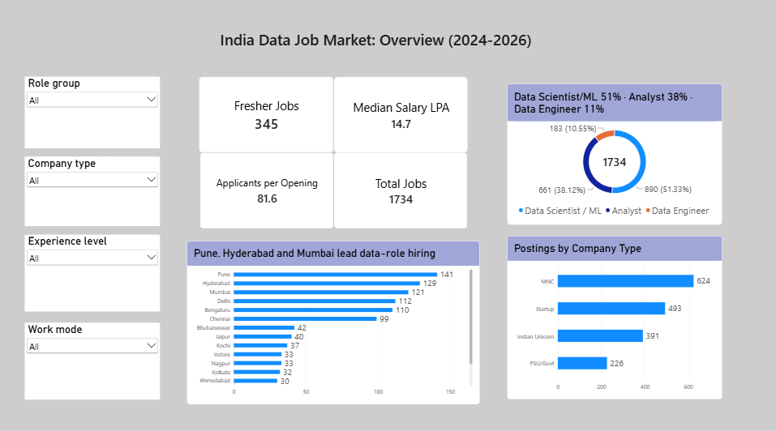
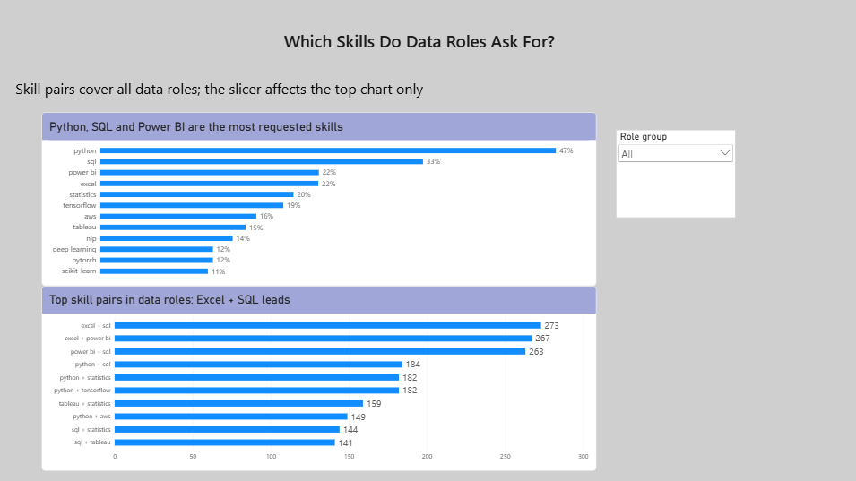
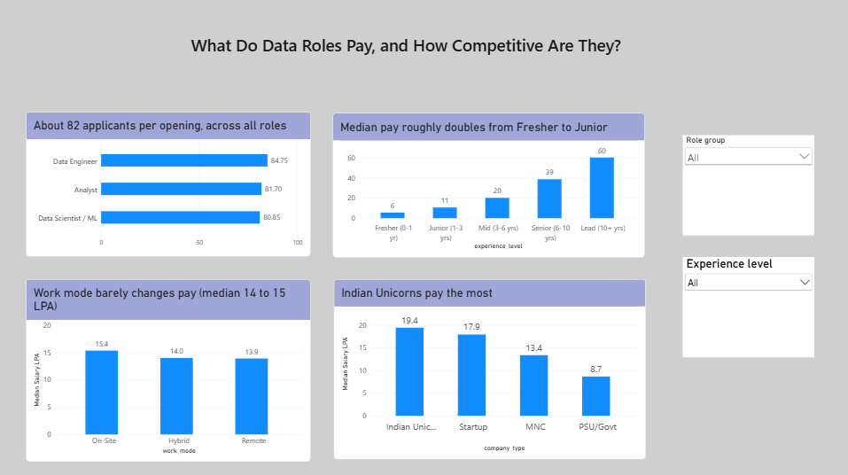
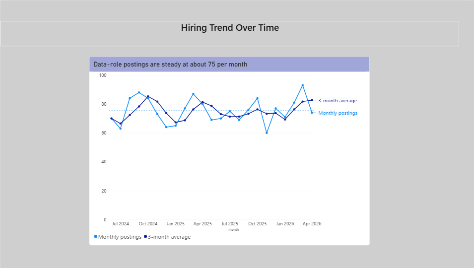

# Job Market Tracker: India Data Roles (2024-2026)

An end-to-end analytics project that answers a practical question for job seekers:
**what skills, pay and competition do data roles in India really have?**

Raw job postings are cleaned with **Python**, modeled in **PostgreSQL**, analysed with
**12 SQL queries** (CTEs, window functions, `NTILE`, `FILTER`), and presented in a
4-page **Power BI** dashboard.

| 5,000 postings | 1,734 data roles | 109 skills | 12 SQL queries | 4 dashboard pages |
|---|---|---|---|---|

## Dashboard






A PDF export is in [`dashboard/job_market_tracker.pdf`](dashboard/job_market_tracker.pdf).

## Key Insights

1. **Analyst roles run on Excel, SQL and Power BI.** Each appears in about 58% of analyst
   postings, and the three are the most common skill pairs. SQL appears in only 10% of
   Data Scientist / ML postings.
2. **Python is the most requested skill**: 47% of data roles (49% of fresher roles),
   ahead of SQL (33%) and Power BI (22%).
3. **Fresher data roles start at a median of 5.2-6.2 LPA** (Analyst 5.2, Data Engineer 5.3,
   Data Scientist/ML 6.2). Median pay roughly doubles from Fresher to Junior (Data Scientist/ML:
   6.2, 11.3, 22.0, 41.6, 69.1 LPA across the five levels).
4. **Indian Unicorns pay fresher data roles the most**: median 7.7 LPA vs 6.0 (Startups),
   5.4 (MNCs) and 4.3 (PSU/Govt).
5. **Work mode barely changes pay**: median 13.9-15.4 LPA across On-Site, Hybrid and Remote.
6. **Pune, Hyderabad and Mumbai have the most data-role postings** (141, 129, 121).
7. **Hiring is steady** at about 75 data-role postings per month, with no clear trend.
8. **GenAI skills** (vector DBs, RAG, LangChain, OpenAI API) appear 3-4 percentage points more
   often in the top-paying quarter of jobs. This is an association, not proof of a salary
   premium, because that group is senior-heavy.

## Architecture

```
Kaggle CSV (5,000 rows)
   -> src/clean.py       Python / Pandas: parse, standardise, extract skills
   -> src/load_db.py     SQLAlchemy -> PostgreSQL (4 tables)
   -> sql/queries.sql    12 analysis queries
   -> sql/views.sql      4 reporting views
   -> Power BI           data model + 8 DAX measures + 4 pages
```

## Data Model

```
companies --< jobs >--< job_skills >-- skills
```

| Table | Purpose |
|---|---|
| `jobs` | One row per posting: title, role group, city, work mode, experience, salary (LPA), openings, applicants, date |
| `companies` | Company names (normalised) |
| `skills` | 109 unique skills |
| `job_skills` | Bridge table: one row per job-skill pair (22,525 rows) |

## What the SQL Covers

| Query | Question | Technique |
|---|---|---|
| Q1 | Top skills in fresher data roles | Joins, aggregation |
| Q2 | Top 5 skills per role group | `ROW_NUMBER() OVER (PARTITION BY ...)` |
| Q3 | Salary by role and experience (average vs median) | `PERCENTILE_CONT` |
| Q4 | Which company type pays freshers most | Aggregation, median |
| Q5 | Applicants per opening | `NULLIF`, casting |
| Q6 | Top hiring companies per role | `RANK()` |
| Q7 | Skills that appear together | Self-join |
| Q8 | Monthly postings, rolling average, change | `DATE_TRUNC`, rolling window, `LAG` |
| Q9 | Skills over-represented in top-paying jobs | `NTILE`, `FILTER`, chained CTEs |
| Q10 | % of jobs requiring SQL by role | CTE + `LEFT JOIN` |
| Bonus A, B | Pay by work mode and by city | Aggregation, `HAVING` |

## Tech Stack

Python (Pandas, SQLAlchemy, psycopg2, python-dotenv) · PostgreSQL · SQL · Power BI (DAX) · Git

## Limitations

- The dataset is a public Kaggle dataset and appears partly synthetic (for example,
  applicants per opening is about 82 for every role), so findings describe **this dataset**,
  not the whole Indian job market.
- Role groups (Analyst, Data Scientist / ML, Data Engineer) come from job-title keywords.
  The remaining titles (software, QA, product, design) were checked and excluded.
- Some groups are small (for example, Data Engineer freshers, n = 36).
- City averages mix seniority levels, so they are indicative only.

## How to Run

**Requirements:** Python 3.10+, PostgreSQL, pgAdmin (or `psql`), Power BI Desktop (to open the report).

1. **Clone and install**
   ```
   git clone https://github.com/[your-username]/job-market-tracker.git
   cd job-market-tracker
   python -m venv venv
   venv\Scripts\activate
   pip install -r requirements.txt
   ```
2. **Create the database** `job_market` in PostgreSQL.
3. **Configure credentials:** copy `.env.example` to `.env` and fill in your password.
4. **Get the data:** download *India Tech Jobs 2024-2026 | Salary & Skills* from Kaggle
   (author: sridipbasu), put the CSV in `data/raw/`, and set `RAW_FILE` at the top of
   `src/clean.py` to its filename.
5. **Run the pipeline**
   ```
   python src/clean.py
   python src/load_db.py
   ```
6. **Create the views:** run `sql/views.sql` in pgAdmin.
7. **Explore:** run queries from `sql/queries.sql`, or open `dashboard/job_market_tracker.pbix`
   (to refresh it, point the PostgreSQL connection at your local database).

## Project Structure

```
job-market-tracker/
├── src/         db.py, inspect_data.py, clean.py, load_db.py
├── sql/         schema.sql, queries.sql, views.sql
├── dashboard/   .pbix report, PDF export, screenshots
├── data/        raw/ and clean/ (not tracked; see How to Run)
└── .env.example
```

## Future Work

- Check the GenAI-skills result within each experience level, to separate skills from seniority
- Schedule the pipeline with Airflow or cron, and containerise it with Docker
- Publish the dashboard to Power BI Service

## Author

**[Mizbha Tabassum]** : [www.linkedin.com/in/mizbha-tabassum-341bb13a6] · [mizbhatabassum713@gmail.com]